# 01 · URL Shortener

**Difficulty:** Beginner · **Stack:** Java 21, Spring Boot (REST API), in-memory store

Turn long URLs into short codes (`https://sho.rt/1000`) and redirect visitors to the original URL. It's a classic warm-up because it touches ID generation, a read-heavy cache, and a hot redirect path.



| | |
|---|---|
| [Design summary](docs/design-summary.md) | Requirements, API, data model, decisions, scaling |
| [Interview questions](docs/interview-questions.md) | 12 questions with short answers |
| [Diagram source](architecture/architecture.mmd) | Mermaid; re-render with [`common/diagrams`](../common/README.md#diagrams) |

## Local implementation vs production

| Concern | This repo (runs locally) | Production design (discussed) |
|---|---|---|
| Storage | `ConcurrentHashMap` (lost on restart) | PostgreSQL, `code` as primary key |
| Read path | Direct map lookup | Redis cache in front of the DB |
| ID generation | `AtomicLong` in one process | Each instance leases ID blocks from a DB sequence |
| Click counts | In-process `LongAdder` | Click events → Kafka → aggregator |
| Instances | One | Many stateless instances behind a load balancer |

The local version is correct for a single process. It doesn't provide durability, replication, or multi-instance ID uniqueness.

## Code map

```
src/main/java/com/sdprep/urlshortener/
├── UrlShortenerApplication.java   Spring Boot entry point
├── AppConfig.java                 Wires the plain-Java core into Spring
├── api/
│   ├── UrlController.java         POST /api/urls, GET /{code}, GET /api/urls/{code}
│   ├── ShortenRequest.java        Request body
│   ├── ShortUrlResponse.java      Response body
│   └── ApiExceptionHandler.java   Domain exceptions → 400/404/409/410
├── core/
│   ├── UrlShortenerService.java   Business rules: validate, generate, resolve, expire
│   ├── Base62.java                ID → short code
│   ├── IdGenerator.java           Unique increasing IDs
│   ├── ClickCounter.java          Per-code click counts
│   ├── ShortUrl.java              The code → URL mapping
│   └── *Exception.java            One per failure case
└── storage/
    ├── UrlRepository.java         Storage interface (atomic saveIfAbsent)
    └── InMemoryUrlRepository.java
```

Start reading at `UrlShortenerService`. It contains every rule; the other classes are small helpers.

## Run it

```bash
cd 01-URL-Shortener
mvn test              # 15 tests: Base62, service rules, HTTP layer
mvn spring-boot:run   # starts on http://localhost:8080
```

```bash
# Create a link (customAlias and expiresInDays are optional)
curl -s -X POST localhost:8080/api/urls -H 'Content-Type: application/json' \
     -d '{"longUrl": "https://en.wikipedia.org/wiki/URL_shortening", "expiresInDays": 30}'
# {"code":"1000","shortUrl":"http://localhost:8080/1000","longUrl":"https://en.wikipedia.org/wiki/URL_shortening",
#  "createdAt":"...","expiresAt":"...","clicks":0}

# Follow it
curl -s -o /dev/null -w "%{http_code} -> %{redirect_url}\n" localhost:8080/1000
# 302 -> https://en.wikipedia.org/wiki/URL_shortening

# Details and click count
curl -s localhost:8080/api/urls/1000
# {..., "clicks":1}
```

## Intentional simplifications
- No authentication, user accounts, or per-user link lists.
- No malicious-URL screening (production would check a blocklist or Safe Browsing API).
- Expired links stay in memory (production deletes them with a scheduled cleanup job).

> For a fuller, deployed version of this design (PostgreSQL, Redis, React UI, load test), see [LinkLens](https://github.com/Jain-Saksham/LinkLens).
