# 02 · Rate Limiter

**Difficulty:** Beginner · **Stack:** Plain Java 21 (no framework), JUnit 5

Limit how many requests each client can make in a time window, and reject the excess with `429 Too Many Requests`. It protects services from abuse, accidental retry storms, and noisy neighbours.



| | |
|---|---|
| [Design summary](docs/design-summary.md) | Algorithms compared, distributed design, Redis Lua script |
| [Interview questions](docs/interview-questions.md) | 12 questions with short answers |
| [Diagram source](architecture/architecture.mmd) | Mermaid; re-render with [`common/diagrams`](../common/README.md#diagrams) |

## Local implementation vs production

| Concern | This repo (runs locally) | Production design (discussed) |
|---|---|---|
| Counter storage | `ConcurrentHashMap` per process | Redis, shared by all gateway instances |
| Atomicity | `synchronized` per client | One Lua script per request (atomic in Redis) |
| Where it runs | Called directly from code | Middleware in the API gateway |
| Rules | Constructor arguments | Config store, cached locally and refreshed |
| Idle clients | Kept in memory forever | Redis keys expire with a TTL |

The local limiters are correct and thread-safe **within one JVM**. Run two instances and each enforces its own limit, so the effective limit doubles. That's exactly why production uses shared Redis state.

## Code map

```
src/main/java/com/sdprep/ratelimiter/
├── RateLimiter.java                       tryAcquire(clientId) → allow / reject
├── TokenBucketRateLimiter.java            Bursts up to capacity, steady refill
├── SlidingWindowCounterRateLimiter.java   Rolling-window limit with two counters
├── MonotonicClock.java                    Time source that never jumps backwards
└── RateLimiterDemo.java                   Runnable walkthrough (simulated time)
```

Each limiter takes a `LongSupplier` clock, so tests and the demo control time exactly. There's no `sleep()` in any test.

## Run it

```bash
cd 02-Rate-Limiter
mvn test                 # 12 tests, including concurrency tests with 500 parallel requests
mvn -q compile && java -cp target/classes com.sdprep.ratelimiter.RateLimiterDemo
```

Demo output:
```
Token bucket: capacity 5, refills 1 token/second
  t=    0 ms  alice  x8 -> 200 200 200 200 200 429 429 429
  t=    0 ms  bob    x2 -> 200 200
  t= 2000 ms  alice  x3 -> 200 200 429

Sliding window counter: 5 requests per rolling 1000 ms
  t=  900 ms  carol  x5 -> 200 200 200 200 200
  t= 1100 ms  carol  x5 -> 200 429 429 429 429
  A fixed-window limiter would have allowed all 10 requests within 200 ms.
  t= 2500 ms  carol  x5 -> 200 200 200 200 200
```

## Intentional simplifications
- Returns a boolean only. A real middleware also returns `X-RateLimit-Limit`, `X-RateLimit-Remaining`, and `Retry-After` headers.
- One rule per limiter instance. Production picks a rule per client tier or endpoint.
- Per-client state is never evicted, so memory grows with the number of distinct clients.
