# 03 · API Gateway

**Difficulty:** Intermediate · **Stack:** Plain Java 21 (JDK `HttpServer` + `HttpClient`), JUnit 5

A single entry point in front of many microservices. It authenticates callers, applies rate limits, routes each request to the right service, and shields clients from backend failures, so every service doesn't have to re-implement these concerns.



| | |
|---|---|
| [Design summary](docs/design-summary.md) | Responsibilities, request pipeline, failure handling, scaling |
| [Interview questions](docs/interview-questions.md) | 11 questions with short answers |
| [Diagram source](architecture/architecture.mmd) | Mermaid; re-render with [`common/diagrams`](../common/README.md#diagrams) |

## Local implementation vs production

| Concern | This repo (runs locally) | Production design (discussed) |
|---|---|---|
| HTTP | Real HTTP on localhost (JDK server + client) | Same idea, on Envoy / Spring Cloud Gateway / Kong behind a load balancer |
| Auth | API key → client ID map in memory | Hashed keys in a DB cached locally, or JWT validated with cached public keys |
| Rate limiting | Fixed window, per process | Redis-backed, shared by all instances (see [02-Rate-Limiter](../02-Rate-Limiter/README.md)) |
| Routes | Passed in at startup | Config store or service registry, hot-reloaded |
| Resilience | Timeouts → 502/504 | Timeouts, retries for idempotent calls, circuit breakers |
| Instances | One | Many stateless instances |

The request pipeline and error mapping are real. Everything that must be shared across instances (rate-limit counters, config) is local here.

## Code map

```
src/main/java/com/sdprep/apigateway/
├── GatewayHandler.java         The pipeline: authenticate → rate limit → route → forward
├── RouteTable.java             Longest-prefix route matching
├── Route.java                  Path prefix → backend base URI
├── ApiKeyAuthenticator.java    API key → client ID
├── FixedWindowRateLimiter.java Per-client request cap
├── BackendClient.java          Forwarding with timeouts; maps failures to exceptions
├── ApiGateway.java             Starts the HTTP server (virtual threads)
├── FakeBackend.java            Stand-in microservice that echoes what it received
└── GatewayDemo.java            Runnable walkthrough
```

Start with `GatewayHandler.handle()`. It reads top to bottom like the pipeline in the diagram.

## Run it

```bash
cd 03-API-Gateway
mvn test     # 14 tests, including end-to-end HTTP tests (401, 404, 429, 502, 504)
mvn -q compile && java -cp target/classes com.sdprep.apigateway.GatewayDemo
```

Demo output (port varies):
```
Gateway on http://localhost:60180 (limit: 5 requests/minute per client)

GET /users/42            key=valid -> 200 {"service":"user-service","path":"/users/42","clientId":"mobile-app","apiKeyForwarded":false}
GET /orders/7            key=valid -> 200 {"service":"order-service","path":"/orders/7?expand=items","clientId":"mobile-app","apiKeyForwarded":false}
GET /users/42            key=none  -> 401 {"error":"Missing or invalid API key","requestId":"…"}
GET /payments/1          key=valid -> 404 {"error":"No route for /payments/1","requestId":"…"}
GET /users/1             key=valid -> 200 {"service":"user-service","path":"/users/1","clientId":"mobile-app","apiKeyForwarded":false}
GET /orders/7            key=valid -> 502 {"error":"Backend unavailable","requestId":"…"}
GET /users/2             key=valid -> 429 {"error":"Rate limit exceeded","requestId":"…"}
```

Note that the backend sees `clientId` but never the API key: the gateway strips credentials and forwards a verified identity.

## Intentional simplifications
- No retries or circuit breaker (explained in the design summary).
- No request aggregation or response caching.
- Only a few headers are forwarded (request ID, client ID, content type). A real gateway forwards most headers and strips hop-by-hop ones.
- The rate limit counts every authenticated request, including ones that later get 404.
