# 04 · Notification System

**Difficulty:** Intermediate · **Stack:** Plain Java 21, JUnit 5

Send email, SMS, and push notifications on behalf of other services, reliably and without spamming users. The interesting parts are asynchronous delivery, per-channel queues, retries with backoff, idempotency, and user preferences.



| | |
|---|---|
| [Design summary](docs/design-summary.md) | Requirements, pipeline, data model, delivery guarantees, scaling |
| [Interview questions](docs/interview-questions.md) | 12 questions with short answers |
| [Diagram source](architecture/architecture.mmd) | Mermaid; re-render with [`common/diagrams`](../common/README.md#diagrams) |

## Local implementation vs production

| Concern | This repo (runs locally) | Production design (discussed) |
|---|---|---|
| Queue | In-memory priority queue ordered by due time | Kafka topic per channel + retry topics (or SQS with delay) |
| Workers | One `DeliveryWorker`, driven by the caller | Worker fleets per channel, scaled independently |
| Providers | Fake `ChannelSender` lambdas | SES/SendGrid, Twilio, APNs/FCM |
| Idempotency | `ConcurrentHashMap` | Redis `SET NX` with TTL, or a unique DB key |
| Preferences, templates | In-memory maps | DB + cache |
| Durability | Lost on restart | Messages persisted in Kafka until acknowledged |

The retry, backoff, dead-letter, preference, and deduplication logic is real. Durability and horizontal scaling come from the production queue, which this repo doesn't run.

## Code map

```
src/main/java/com/sdprep/notification/
├── NotificationService.java   API: dedupe → preferences → render → queue one task per channel
├── DeliveryWorker.java        Sends due tasks; retry with exponential backoff; dead-letter after max attempts
├── DeliveryQueue.java         Tasks ordered by due time (stands in for Kafka)
├── DeliveryTask.java          One message, one channel, one address, attempt number
├── TemplateRenderer.java      "Hi {{name}}" + params → message
├── UserDirectory.java         Profiles by user ID
├── UserProfile.java           Addresses per channel + opted-out channels
├── ChannelSender.java         Provider interface (email/SMS/push)
├── NotificationRequest.java   What a caller sends (with idempotency key)
├── SendResult.java            Queued / skipped channels, duplicate flag
├── Channel.java               EMAIL, SMS, PUSH
└── NotificationDemo.java      Runnable walkthrough (simulated time)
```

## Run it

```bash
cd 04-Notification-System
mvn test     # 11 tests: rendering, preferences, idempotency, backoff timing, dead letters
mvn -q compile && java -cp target/classes com.sdprep.notification.NotificationDemo
```

Demo output:
```
send()   -> queued [EMAIL, SMS], skipped [PUSH] (opted out)
retry    -> duplicate=true (same idempotency key, nothing re-queued)

t=   0 ms  worker run:
           EMAIL to asha@example.com  OK   "Hi Asha, your order #981 has shipped!"
           SMS   to +91-98000-00042   FAILED (provider timeout), will retry
t=1000 ms  worker run:
           SMS   to +91-98000-00042   FAILED (provider timeout), will retry
t=2000 ms  worker run:
           nothing due (SMS retry is backing off)
t=3000 ms  worker run:
           SMS   to +91-98000-00042   OK   "Hi Asha, your order #981 has shipped!"

Delivered: 2, dead letters: 0
```

## Intentional simplifications
- One template per notification. Production has per-channel and per-locale variants (an SMS is shorter than an email).
- No per-user rate limiting or quiet hours (covered in the design summary).
- No delivery status tracking (sent, delivered, opened) via provider callbacks.
- Idempotency keys are kept forever. Production expires them after a TTL.
