# 05 · Chat Messaging System

**Difficulty:** Advanced · **Stack:** Plain Java 21, JUnit 5

One-to-one and group chat in the style of WhatsApp or Messenger: real-time delivery to online users, push notifications for offline users, sync of missed messages on reconnect, consistent ordering, and sent/delivered/read receipts.



| | |
|---|---|
| [Design summary](docs/design-summary.md) | Connections, ordering, storage, receipts, scaling |
| [Interview questions](docs/interview-questions.md) | 12 questions with short answers |
| [Diagram source](architecture/architecture.mmd) | Mermaid; re-render with [`common/diagrams`](../common/README.md#diagrams) |

## Local implementation vs production

| Concern | This repo (runs locally) | Production design (discussed) |
|---|---|---|
| Client connections | `ClientConnection` callback in memory | WebSockets held by a fleet of gateway servers |
| Routing to recipient | Direct map lookup `userId → connection` | Redis presence (`user → gateway`) + pub/sub to that gateway |
| Message storage | In-memory list per conversation | Cassandra, partitioned by conversation, clustered by sequence |
| Delivery ack | Assumed on `deliver()` | Device acks; cursor advances only after the ack |
| Offline users | `PushNotifier` callback | Push service → APNs / FCM |
| Servers | One process | Many gateways and chat-service instances |

The ordering, deduplication, offline sync, and receipt logic is real. Cross-server routing and durability are production concerns this repo describes but doesn't run.

## Code map

```
src/main/java/com/sdprep/chat/
├── ChatService.java       send → store → fan out (online: deliver, offline: push); connect → sync missed
├── MessageStore.java      Append-only log per conversation; assigns sequence; dedupes by clientMessageId
├── ReceiptCursors.java    Per member: delivered-up-to and read-up-to sequence
├── Message.java           conversationId, sequence, clientMessageId, sender, text
├── MessageStatus.java     SENT / DELIVERED / READ
├── ClientConnection.java  A connected device (WebSocket stand-in)
├── PushNotifier.java      Offline wake-up (APNs/FCM stand-in)
└── ChatDemo.java          Runnable walkthrough
```

## Run it

```bash
cd 05-Chat-Messaging-System
mvn test     # 11 tests: live delivery, offline sync, dedupe, receipts, concurrent sequencing
mvn -q compile && java -cp target/classes com.sdprep.chat.ChatDemo
```

Demo output:
```
alice and carol are online; bob is offline

alice sends two messages:
  [push → bob] new message from alice
  [carol's device] #1 alice: Flight lands at 6pm
  [push → bob] new message from alice
  [carol's device] #2 alice: Who's picking us up?
  status of #1: SENT (bob hasn't received it)

alice's app retries message a-2 after a network timeout:
  server returns existing #2, nothing delivered twice

bob comes online and syncs what he missed:
  [bob's device] #1 alice: Flight lands at 6pm
  [bob's device] #2 alice: Who's picking us up?
  status of #1: DELIVERED

bob and carol read up to #2:
  status of #1: READ
```

## Intentional simplifications
- One device per user. Multi-device needs a cursor per device, plus delivery to every device.
- No end-to-end encryption, media attachments, typing indicators, or "last seen" timestamps.
- Delivery is counted when `deliver()` returns, not on a real client acknowledgement.
- Fan-out happens in the sending thread. Production hands it to the routing layer asynchronously.
