# 06 · News Feed System

**Difficulty:** Advanced · **Stack:** Plain Java 21, JUnit 5

Show each user a reverse-chronological feed of posts from people they follow, as on Twitter/X, Instagram, or LinkedIn. The core question is when to do the work: push posts into followers' feeds at write time, or assemble feeds at read time. The answer is both.



| | |
|---|---|
| [Design summary](docs/design-summary.md) | Fan-out strategies, data model, ranking, scaling |
| [Interview questions](docs/interview-questions.md) | 12 questions with short answers |
| [Diagram source](architecture/architecture.mmd) | Mermaid; re-render with [`common/diagrams`](../common/README.md#diagrams) |

## Local implementation vs production

| Concern | This repo (runs locally) | Production design (discussed) |
|---|---|---|
| Feed cache | `ConcurrentSkipListSet` of post IDs per user | Redis sorted set per user, trimmed to ~500 IDs |
| Fan-out | Synchronous loop inside `publish()` | Kafka + fan-out worker fleet (asynchronous) |
| Posts | In-memory maps | Cassandra/MySQL + Redis post cache |
| Follow graph | Two in-memory maps | Sharded tables or a graph store |
| Ranking | Reverse chronological | ML ranking over candidate posts |
| Post IDs | `AtomicLong` | Snowflake IDs (time-ordered, generated without coordination) |

The hybrid fan-out, merge, cursor pagination, backfill-on-follow, and lazy unfollow handling are real. The asynchronous worker pipeline and distributed storage are described but not run.

## Code map

```
src/main/java/com/sdprep/newsfeed/
├── FeedService.java    publish (push for regular users), getFeed (merge pushed + pulled), follow/unfollow
├── FeedCache.java      Precomputed feed: post IDs per user, newest first, capped
├── PostStore.java      Posts by ID and by author
├── FollowGraph.java    Followers and following, both directions
├── Post.java           id (time-ordered), author, text
├── FeedPage.java       One page + nextCursor
└── NewsFeedDemo.java   Runnable walkthrough
```

## Run it

```bash
cd 06-News-Feed-System
mvn test     # 8 tests: push, pull, merge order, pagination, unfollow, backfill, cache cap
mvn -q compile && java -cp target/classes com.sdprep.newsfeed.NewsFeedDemo
```

Demo output:
```
Celebrity threshold: 3 followers (demo scale; real systems use ~10k+)

bob has 1 follower    -> celebrity? false
taylor has 3 followers -> celebrity? true

bob    posts #1 "Morning run done" -> 2 feed write(s)
taylor posts #2 "New album out tonight!" -> 1 feed write(s) (own feed only; followers pull)
bob    posts #3 "Coffee anyone?" -> 2 feed write(s)

ana's feed (2 per page):
  page 1:
    #3 bob     Coffee anyone?
    #2 taylor  New album out tonight!
  page 2:
    #1 bob     Morning run done
```

## Intentional simplifications
- Chronological order only. Ranking, ads, and "suggested posts" are discussed in the design summary.
- A user's celebrity status is evaluated at read and write time. If someone crosses the threshold, posts they already fanned out stay in caches; duplicates are removed during the merge.
- No likes, comments, media, or privacy settings.
