# 07 · Web Crawler

**Difficulty:** Intermediate · **Stack:** Plain Java 21, JUnit 5

Discover and download web pages by following links from a set of seed URLs, the first stage of a search engine. The challenges are scale (billions of pages), politeness (don't overload any site), and avoiding duplicate work (the same page under many URLs, link cycles, mirrors).



| | |
|---|---|
| [Design summary](docs/design-summary.md) | Frontier design, politeness, deduplication, distribution |
| [Interview questions](docs/interview-questions.md) | 12 questions with short answers |
| [Diagram source](architecture/architecture.mmd) | Mermaid; re-render with [`common/diagrams`](../common/README.md#diagrams) |

## Local implementation vs production

| Concern | This repo (runs locally) | Production design (discussed) |
|---|---|---|
| Fetching | `InMemoryWeb` (fake internet) behind `PageFetcher` | HTTP client with timeouts, size limits, redirects, User-Agent |
| Frontier | In-memory per-host queues | Distributed queues (Kafka/Redis), persisted, with priorities |
| Seen URLs | `HashSet` | Bloom filter + persistent store, sharded by URL hash |
| Workers | One thread | Hundreds of workers, each owning a set of hosts |
| Link extraction | Regex on `href` | HTML parser (jsoup), handles broken markup and `<base>` |
| Time | Simulated clock (politeness waits are instant) | Real clock |

The crawl loop, URL normalization, robots.txt rules, per-host politeness, content deduplication, and scope/depth limits are real. Distribution and persistence are described but not run. The code never touches the real internet, so tests are fast and deterministic.

## Code map

```
src/main/java/com/sdprep/crawler/
├── Crawler.java         The loop: polite URL → fetch → dedupe content → extract → filter → enqueue
├── UrlFrontier.java     Per-host FIFO queues + "next allowed fetch" time per host
├── UrlNormalizer.java   One canonical form per URL (case, ports, fragments, relative links)
├── LinkExtractor.java   href="..." → normalized URLs
├── RobotsRules.java     Parses Disallow rules for User-agent: *
├── CrawlClock.java      Real or simulated time
├── PageFetcher.java     Fetch interface
├── InMemoryWeb.java     Fake internet for demo/tests
├── CrawlResult.java     Crawled, blocked, duplicate, failed
└── CrawlerDemo.java     Runnable walkthrough
```

## Run it

```bash
cd 07-Web-Crawler
mvn test     # 16 tests: normalization, robots, politeness timing, depth/page limits, dedupe, scope
mvn -q compile && java -cp target/classes com.sdprep.crawler.CrawlerDemo
```

Demo output:
```
Politeness delay: 1000 ms per host. Fetch order (simulated time):
  t=   0 ms  depth 0  https://shop.example/
  t=   0 ms  depth 0  https://blog.example/
  t=1000 ms  depth 1  https://shop.example/products
  t=1000 ms  depth 1  https://blog.example/post-1
  t=2000 ms  depth 2  https://shop.example/products/1
  t=3000 ms  depth 2  https://shop.example/products/2

Blocked by robots.txt: [https://shop.example/admin]
Duplicate content:     [https://shop.example/index.html]
Failed (non-200):      [https://blog.example/post-2]
Never fetched:         https://ads.tracker/x (outside the seed hosts)
```

The two sites are fetched in parallel time slots, but pages on the same site are always ≥ 1000 ms apart. `/products/2#reviews` was normalized to `/products/2`, and `/index.html` was recognized as the same content as `/`.

## Intentional simplifications
- Stays within the seed hosts; a general crawler would follow all domains with a priority policy.
- No re-crawl scheduling (freshness), no `Crawl-delay` or `Allow` rules, no sitemap support.
- robots.txt fetches aren't themselves rate-limited.
- Content duplicates are detected by exact hash. Near-duplicates need SimHash or MinHash.
