# 08 · Search Autocomplete

**Difficulty:** Intermediate · **Stack:** Plain Java 21, JUnit 5

Suggest the most popular completions as a user types into a search box ("jav" → "javascript", "java", ...). Every keystroke is a request, so lookups must take a few milliseconds. Suggestions come from aggregated search history, rebuilt periodically.



| | |
|---|---|
| [Design summary](docs/design-summary.md) | Trie with cached top-k, build pipeline, caching layers, scaling |
| [Interview questions](docs/interview-questions.md) | 11 questions with short answers |
| [Diagram source](architecture/architecture.mmd) | Mermaid; re-render with [`common/diagrams`](../common/README.md#diagrams) |

## Local implementation vs production

| Concern | This repo (runs locally) | Production design (discussed) |
|---|---|---|
| Trie | In-memory, built in-process | Same structure, built offline and loaded by every suggestion server |
| Counting searches | `ConcurrentHashMap<String, LongAdder>` | Kafka → Spark/Flink aggregation per time window, with decay |
| Rebuild | `rebuild()` call, atomic reference swap | Hourly/daily job → snapshot in object storage → servers hot-swap |
| Caching | None needed locally | Browser cache + CDN for short, popular prefixes |
| Scale | One process | Replicated (and possibly prefix-sharded) suggestion servers |

The trie, precomputed top-k, normalization, blocked-term filtering, and atomic swap are real. The data pipeline and caching tiers are described but not run.

## Code map

```
src/main/java/com/sdprep/autocomplete/
├── AutocompleteTrie.java     Prefix tree; each node stores its top-k completions
├── AutocompleteService.java  Serves from the current trie; rebuild() merges counts and swaps atomically
├── QueryCounter.java         Counts submitted searches
├── QueryNormalizer.java      Lowercase, trim, collapse spaces
├── Suggestion.java           query + count, ordering
└── AutocompleteDemo.java     Runnable walkthrough
```

## Run it

```bash
cd 08-Search-Autocomplete
mvn test     # 9 tests: ranking, tie-breaks, normalization, rebuild, blocked terms
mvn -q compile && java -cp target/classes com.sdprep.autocomplete.AutocompleteDemo
```

Demo output:
```
  "j"       -> [javascript (1200), java (900), java interview questions (400)]
  "jav"     -> [javascript (1200), java (900), java interview questions (400)]
  "JAVA "   -> [javascript (1200), java (900), java interview questions (400)]
  "jz"      -> []

Users search "java streams" 1,000 times...
  "java s"  -> []
  (not visible yet: counts are applied when the trie is rebuilt)

After rebuild:
  "java s"  -> [java streams (1000)]
  "jav"     -> [javascript (1200), java streams (1000), java (900)]
```

"jail break" (500 searches) is in the history but on the block list, so it never appears under "j".

## Intentional simplifications
- Ranking uses raw counts. Production adds recency decay, personalization, location, and trending boosts.
- No typo tolerance (fuzzy matching) and no multi-language tokenization.
- The trie holds every query. Production prunes rare queries (e.g., < 10 searches) to bound memory.
