# 09 · File Storage System

**Difficulty:** Advanced · **Stack:** Plain Java 21, JUnit 5

An S3-style object store: put, get, list, and delete files ("objects") in buckets, durably and at massive scale. The key ideas are separating metadata from data, chunking, replication, checksums, and the write order that keeps readers from ever seeing half-written objects.



| | |
|---|---|
| [Design summary](docs/design-summary.md) | Metadata vs data tiers, durability, placement, consistency |
| [Interview questions](docs/interview-questions.md) | 12 questions with short answers |
| [Diagram source](architecture/architecture.mmd) | Mermaid; re-render with [`common/diagrams`](../common/README.md#diagrams) |

## Local implementation vs production

| Concern | This repo (runs locally) | Production design (discussed) |
|---|---|---|
| Data nodes | `StorageNode` objects (maps) in one JVM | Thousands of machines with many disks |
| Metadata | `TreeMap` per bucket | Replicated, sharded, strongly consistent DB |
| Replication | 3 synchronous in-memory copies | 3 copies across racks/zones, or erasure coding (e.g., 6+3) |
| Failures | `setUp(false)`, `corrupt()` switches | Real crashes, disk rot; background repair and scrubbing |
| Chunk size | Tiny (bytes) to make chunking visible | 4–64 MB; multipart upload for large files |
| API | Java methods | HTTP (`PUT /bucket/key`), presigned URLs |

Chunking, content-addressed chunk IDs (dedup + checksums), rendezvous placement, the metadata-last commit, and replica fallback on failure or corruption are real. All "nodes" run in one process, so there's **no real durability or fault isolation**.

## Code map

```
src/main/java/com/sdprep/filestorage/
├── ObjectStorageService.java  put (chunk → replicate → commit metadata), get (verify checksums), list, delete
├── MetadataStore.java         bucket → sorted keys → metadata (prefix listing)
├── ReplicaPlacement.java      Rendezvous hashing: pick N nodes per chunk
├── StorageNode.java           One data server (with outage/corruption switches)
├── ObjectMetadata.java        size, etag, chunk list, version
├── ChunkRef.java              chunk ID (SHA-256) + replica nodes
├── StorageExceptions.java     NotFound (404), Unavailable (503)
└── FileStorageDemo.java       Runnable walkthrough
```

## Run it

```bash
cd 09-File-Storage-System
mvn test     # 11 tests: round trip, replication, node failure, corruption, dedup, versions, listing
mvn -q compile && java -cp target/classes com.sdprep.filestorage.FileStorageDemo
```

Demo output:
```
5 storage nodes, 16-byte chunks (tiny, to show chunking), 3 replicas per chunk

PUT photos/2026/cat.jpg (36 bytes) -> 3 chunks, version 1
  chunk ddf71c0f… (16 B) on [node-4, node-2, node-5]
  chunk 07136bf2… (16 B) on [node-1, node-3, node-2]
  chunk 6a93660f… ( 4 B) on [node-1, node-5, node-2]

node-4 goes down...
GET -> "A picture is worth a thousand words." (read from the next replica)

A disk on node-1 silently corrupts chunk 07136bf2…
GET -> intact=true (checksum mismatch detected, other replica used)

node-4 recovers.
PUT an identical file as cat-copy.jpg -> new chunk copies stored: 0 (content-addressed dedup)
LIST photos/2026/ -> [2026/cat-copy.jpg, 2026/cat.jpg]
```

## Intentional simplifications
- No background repair: a corrupted or lost replica isn't re-created.
- Deleting removes metadata only; unreferenced chunks aren't garbage-collected.
- No multipart upload, versioning history (only a version counter), access control, or presigned URLs.
- Writes require all N replicas. Production often acknowledges after a write quorum and repairs the rest.
