# 10 · Video Streaming System

**Difficulty:** Advanced · **Stack:** Plain Java 21, JUnit 5

Upload videos once and stream them smoothly to millions of viewers on any network, like YouTube or Netflix. The core ideas are an asynchronous transcoding pipeline, segmenting video into small files, HLS playlists, adaptive bitrate (ABR) switching on the player, and serving everything from a CDN.



| | |
|---|---|
| [Design summary](docs/design-summary.md) | Pipeline, segments and playlists, ABR, CDN, storage costs |
| [Interview questions](docs/interview-questions.md) | 12 questions with short answers |
| [Diagram source](architecture/architecture.mmd) | Mermaid; re-render with [`common/diagrams`](../common/README.md#diagrams) |

## Local implementation vs production

| Concern | This repo (runs locally) | Production design (discussed) |
|---|---|---|
| Transcoding | **Simulated:** records segment paths and sizes | FFmpeg / hardware encoders on a worker fleet |
| Job queue | In-memory queue | Durable queue (SQS/Kafka) with retries |
| Segments | `SegmentStore` map of path → size | Object storage as the CDN origin |
| Playlists | Real HLS `.m3u8` text, generated on request | Same format, written to storage next to segments |
| ABR | Real decision logic, driven by a scripted network trace | Same idea inside the player (hls.js, ExoPlayer, AVPlayer) |
| Delivery | Not modelled | CDN edge caches; the origin is rarely hit |

Splitting into jobs, the completion → READY transition, HLS playlist structure, and ABR switching rules are real. No actual video is encoded or streamed.

## Code map

```
src/main/java/com/sdprep/video/
├── VideoService.java              upload → submit jobs; serve playlists only when READY
├── TranscodingPipeline.java       One job per (segment, rendition); marks READY after the last job
├── HlsManifests.java              Master playlist (renditions) + media playlist (segments)
├── AdaptiveBitrateSelector.java   Player-side choice of next rendition from bandwidth + buffer
├── Rendition.java                 240p / 360p / 720p / 1080p ladder
├── Video.java                     Duration, status, segment math
├── SegmentStore.java              Produced segments (path → size)
└── VideoStreamingDemo.java        Runnable walkthrough
```

## Run it

```bash
cd 10-Video-Streaming-System
mvn test     # 14 tests: job fan-out, READY transition, segment sizes, playlist format, ABR rules
mvn -q compile && java -cp target/classes com.sdprep.video.VideoStreamingDemo
```

Demo output:
```
Uploaded v1 (20 s) -> 16 transcode jobs (4 segments × 4 renditions), status PROCESSING
Play request -> rejected: Video v1 is still processing
Workers finished -> status READY, 16 segments stored (22.5 MB)

master.m3u8:
  #EXTM3U
  #EXT-X-STREAM-INF:BANDWIDTH=400000,RESOLUTION=426x240
  240p/playlist.m3u8
  #EXT-X-STREAM-INF:BANDWIDTH=800000,RESOLUTION=640x360
  360p/playlist.m3u8
  #EXT-X-STREAM-INF:BANDWIDTH=2800000,RESOLUTION=1280x720
  720p/playlist.m3u8
  #EXT-X-STREAM-INF:BANDWIDTH=5000000,RESOLUTION=1920x1080
  1080p/playlist.m3u8
720p/playlist.m3u8:
  #EXTM3U
  #EXT-X-VERSION:3
  #EXT-X-TARGETDURATION:6
  #EXT-X-MEDIA-SEQUENCE:0
  #EXT-X-PLAYLIST-TYPE:VOD
  #EXTINF:6.000,
  seg_0.ts
  #EXTINF:6.000,
  seg_1.ts
  #EXTINF:6.000,
  seg_2.ts
  #EXTINF:2.000,
  seg_3.ts
  #EXT-X-ENDLIST

Adaptive bitrate session (player decides before each segment):
  bandwidth 6000 kbps, buffer  0 s -> 240p
  bandwidth 6000 kbps, buffer  8 s -> 240p
  bandwidth 6000 kbps, buffer 16 s -> 360p   ↑ up one level
  bandwidth 6000 kbps, buffer 20 s -> 720p   ↑ up one level
  bandwidth 1500 kbps, buffer 22 s -> 360p   ↓ down
  bandwidth  700 kbps, buffer 12 s -> 240p   ↓ down
  bandwidth  900 kbps, buffer  4 s -> 240p
  bandwidth 7000 kbps, buffer 18 s -> 360p   ↑ up one level
```

The player starts low for a fast first frame, climbs one level at a time once the buffer is healthy, and drops immediately when bandwidth falls.

## Intentional simplifications
- No real encoding, DRM, thumbnails, captions, or audio tracks.
- No live streaming. Live uses rolling playlists without `#EXT-X-ENDLIST` and low-latency segments.
- One job queue processed in order. Production prioritizes (e.g., 360p first so videos become playable sooner) and retries failed jobs.
