# 11 · Ride Sharing System

**Difficulty:** Advanced · **Stack:** Plain Java 21, JUnit 5

Match riders with nearby drivers in real time, like Uber or Lyft. The hard parts are indexing millions of moving drivers so "who's near this pickup?" is fast, ingesting a flood of GPS updates, and making sure one driver is never assigned to two riders.



| | |
|---|---|
| [Design summary](docs/design-summary.md) | Geospatial indexing, location ingestion, matching, consistency |
| [Interview questions](docs/interview-questions.md) | 12 questions with short answers |
| [Diagram source](architecture/architecture.mmd) | Mermaid; re-render with [`common/diagrams`](../common/README.md#diagrams) |

## Local implementation vs production

| Concern | This repo (runs locally) | Production design (discussed) |
|---|---|---|
| Geo index | Grid of 0.01° cells in a `ConcurrentHashMap` | Redis GEO (geohash) or H3 hexagons, sharded by city/region |
| Location updates | Method call | Millions of pings/s over WebSockets → location service → Kafka |
| Driver offers | `BiPredicate` that accepts or declines instantly | Push to driver app, wait ~15 s, timeout = decline |
| Driver reservation | `ConcurrentHashMap.replace` (atomic CAS) | Atomic operation in the driver-state store (Redis `SET NX` / DB conditional update) |
| Fare | Base + per-km on straight-line distance | Routing engine distance/time + surge pricing |
| Trips | In-memory map | PostgreSQL |

Spatial search with neighbouring cells, nearest-first matching, decline handling, radius widening, atomic driver reservation, and trip state transitions are real. The location pipeline and multi-region scaling are described but not run.

## Code map

```
src/main/java/com/sdprep/ridesharing/
├── MatchingService.java   requestRide: search → offer nearest → atomic reserve → trip; trip lifecycle
├── GridIndex.java         Driver locations bucketed into cells; nearby(center, radius)
├── Location.java          lat/lng + haversine distance
├── Trip.java              DRIVER_ASSIGNED → IN_PROGRESS → COMPLETED
├── FareCalculator.java    Upfront fare estimate
└── RideSharingDemo.java   Runnable walkthrough
```

## Run it

```bash
cd 11-Ride-Sharing-System
mvn test     # 13 tests: haversine, cell-boundary search, nearest-first, declines, radius widening, 50 concurrent riders
mvn -q compile && java -cp target/classes com.sdprep.ridesharing.RideSharingDemo
```

Demo output:
```
Drivers within 2 km of the pickup:
  dev   0.08 km
  asha  0.62 km

Rider priya requests a ride to Koramangala:
  offer t1 to dev   -> declined
  offer t2 to asha  -> accepted
  matched with asha, upfront fare ₹108.30
  asha is now ON_TRIP; dev is AVAILABLE

Trip t2 COMPLETED; asha is AVAILABLE again, now at the drop-off point
```

## Intentional simplifications
- Offers are sequential and instant. Production offers with a timeout and may batch-match many riders and drivers together to optimize globally.
- No surge pricing, ETAs from road networks, rider cancellation, or ride pooling.
- An on-trip driver stays in the geo index; matching filters by status instead.
