# 12 · Food Delivery System

**Difficulty:** Intermediate · **Stack:** Plain Java 21, JUnit 5

Coordinate customers, restaurants, and couriers around each order, as on DoorDash, Swiggy, or Uber Eats. The core of the design is a strict order state machine, courier dispatch timed against food preparation, ETA estimation, and live status updates to the customer.



| | |
|---|---|
| [Design summary](docs/design-summary.md) | Order lifecycle, dispatch timing, events, consistency, scaling |
| [Interview questions](docs/interview-questions.md) | 11 questions with short answers |
| [Diagram source](architecture/architecture.mmd) | Mermaid; re-render with [`common/diagrams`](../common/README.md#diagrams) |

## Local implementation vs production

| Concern | This repo (runs locally) | Production design (discussed) |
|---|---|---|
| Order state | Enum state machine in memory | Same rules, persisted in PostgreSQL with status history |
| Events | Listener callbacks per order | Kafka `order-events` → dispatch, notifications, analytics |
| Dispatch | Nearest free courier, synchronous on acceptance | Event-driven; geo index; batching; courier accepts/declines |
| Courier locations | Flat x/y in km | Lat/lng in Redis GEO (see [11-Ride-Sharing](../11-Ride-Sharing-System/README.md)) |
| ETA | Formula: max(prep, courier travel) + delivery travel | ML-predicted prep times + routing engine |
| Apps | Method calls | Customer, restaurant, and courier apps calling REST APIs |

The state machine, cancellation rules, dispatch reservation, waiting-for-courier retry, ETA logic, and status publishing are real. Persistence, Kafka, and real apps are described but not run.

## Code map

```
src/main/java/com/sdprep/fooddelivery/
├── OrderService.java     Lifecycle actions (accept, prepare, ready, pick up, deliver, cancel) + events
├── OrderStatus.java      State machine: allowed next statuses
├── Order.java            Status, history, assigned courier
├── DispatchService.java  Nearest free courier, atomic reserve/release
├── EtaCalculator.java    max(prep, courier → restaurant) + restaurant → customer
├── Restaurant.java       Location + typical prep time
├── Location.java         Flat-map coordinates
└── FoodDeliveryDemo.java Runnable walkthrough
```

## Run it

```bash
cd 12-Food-Delivery-System
mvn test     # 12 tests: transitions, cancellation window, dispatch, courier release, waiting orders, ETA
mvn -q compile && java -cp target/classes com.sdprep.fooddelivery.FoodDeliveryDemo
```

Demo output:
```
Order o1001 placed at Napoli Pizza (status PLACED)
  [customer app] t= 1 min  ACCEPTED
  courier assigned: sam (nearest free courier), ETA 28 min
  [customer app] t= 2 min  PREPARING
  customer tries to cancel -> rejected: Order o1001 cannot go from PREPARING to CANCELLED
  [customer app] t=16 min  READY_FOR_PICKUP
  [customer app] t=17 min  PICKED_UP
  [customer app] t=30 min  DELIVERED
  sam is free again at the customer's location
```

## Intentional simplifications
- A courier is assigned the moment the restaurant accepts. Production delays dispatch so the courier arrives just as food is ready.
- No payments, refunds, menus, carts, or courier acceptance/decline.
- One order per courier (no batching of nearby orders).
- Courier location doesn't move during a delivery; ETA isn't updated live.
