# 13 · E-commerce System

**Difficulty:** Intermediate · **Stack:** Java 21, Spring Boot (REST API), in-memory stores

An online store (Amazon-style): browse a catalog, fill a cart, and check out. Browsing is read-heavy and easy to cache; checkout is where correctness matters, with no overselling, no double charges, and clean recovery when payment fails.



| | |
|---|---|
| [Design summary](docs/design-summary.md) | Read vs write paths, inventory consistency, checkout saga, scaling |
| [Interview questions](docs/interview-questions.md) | 12 questions with short answers |
| [Diagram source](architecture/architecture.mmd) | Mermaid; re-render with [`common/diagrams`](../common/README.md#diagrams) |

## Local implementation vs production

| Concern | This repo (runs locally) | Production design (discussed) |
|---|---|---|
| Catalog / search | In-memory list | Product DB + Elasticsearch + CDN/cache |
| Carts | `ConcurrentHashMap` | Redis/DynamoDB keyed by user |
| Inventory | `synchronized` all-or-nothing reserve | Conditional `UPDATE ... WHERE available >= qty` in a DB transaction |
| Payment | Fake gateway: declines charges over ₹10,000 | Payment service (see [14-Payment-System](../14-Payment-System/README.md)) |
| Idempotency | `computeIfAbsent` on the key | Unique constraint on the idempotency key column |
| Order events | Not modelled | Kafka `order-placed` → fulfilment, email, analytics |

Checkout logic (reserve → charge → commit or compensate), price snapshots, idempotent retries, and no-overselling under concurrency are real and tested. Everything is in memory in one process.

## Code map

```
src/main/java/com/sdprep/ecommerce/
├── EcommerceApplication.java   Spring Boot entry point
├── AppConfig.java              Wires the core; seeds 3 products and stock
├── api/
│   ├── StoreController.java    Products, inventory, cart, orders endpoints
│   └── ApiExceptionHandler.java 400 / 404 / 409 mapping
└── core/
    ├── CheckoutService.java    The saga: reserve stock → charge → commit or release
    ├── Inventory.java          available + reserved per product; all-or-nothing reserve
    ├── CartService.java        Cart per user (no stock held)
    ├── Catalog.java, Product.java, Order.java
    ├── PaymentGateway.java     Charge interface
    └── *Exception.java
```

Start with `CheckoutService.placeOrder()`.

## Run it

```bash
cd 13-E-commerce-System
mvn test              # 10 tests: saga success/failure, all-or-nothing, idempotency, price snapshot, 50 concurrent buyers, HTTP
mvn spring-boot:run   # http://localhost:8080
```

```bash
$ curl -s localhost:8080/api/products
[{"id":"p1","name":"Mechanical Keyboard","priceCents":499900},{"id":"p2","name":"Wireless Mouse","priceCents":149900},{"id":"p3","name":"4K Monitor","priceCents":2499900}]

$ curl -s -X POST localhost:8080/api/carts/alice/items -H "Content-Type: application/json" -d '{"productId":"p1","quantity":2}'
{"items":{"p1":2},"totalCents":999800}

$ curl -s -i -X POST localhost:8080/api/orders -H "Idempotency-Key: 7f3a" -H "Content-Type: application/json" -d '{"userId":"alice"}'
HTTP/1.1 201
{"id":"ord-1","userId":"alice","lines":[{"productId":"p1","productName":"Mechanical Keyboard","quantity":2,"unitPriceCents":499900}],"totalCents":999800,"status":"PAID"}

# Same request again (a double-click): the same order comes back; nothing is charged twice.
HTTP/1.1 201
{"id":"ord-1", ... "status":"PAID"}

$ curl -s localhost:8080/api/inventory
{"p1":{"available":3,"reserved":0},"p2":{"available":10,"reserved":0},"p3":{"available":1,"reserved":0}}

# bob buys the 4K monitor, above the fake card limit: 402, and the stock is released.
HTTP/1.1 402
{"id":"ord-2","userId":"bob", ... "totalCents":2499900,"status":"PAYMENT_FAILED"}
```

## Intentional simplifications
- No reservation timeouts: production expires a held reservation if the checkout never completes.
- No user accounts, addresses, shipping, tax, coupons, or order cancellation and returns.
- Payment is a single synchronous call. Production may authorize first and capture at shipment.
