# 14 · Payment System

**Difficulty:** Advanced · **Stack:** Java 21, Spring Boot (REST API), in-memory stores

Accept card payments through an external provider (Stripe, Adyen, Razorpay), refund them, and keep books that always balance. The design is dominated by correctness: idempotency so nothing is charged twice, honest handling of unknown outcomes, a double-entry ledger, and reconciliation against the provider's records.



| | |
|---|---|
| [Design summary](docs/design-summary.md) | Payment states, idempotency, ledger, reconciliation, failure handling |
| [Interview questions](docs/interview-questions.md) | 12 questions with short answers |
| [Diagram source](architecture/architecture.mmd) | Mermaid; re-render with [`common/diagrams`](../common/README.md#diagrams) |

## Local implementation vs production

| Concern | This repo (runs locally) | Production design (discussed) |
|---|---|---|
| Provider | `FakePaymentProvider` with test tokens (approve, decline, timeout) | Stripe/Adyen API + webhooks |
| Idempotency keys | `ConcurrentHashMap.computeIfAbsent` | Unique constraint in PostgreSQL, same transaction as the payment row |
| Payments & ledger | In-memory, append-only list for the ledger | PostgreSQL tables; ledger rows never updated or deleted |
| Reconciliation | `POST /api/reconciliation` on demand | Scheduled job + provider's daily settlement file |
| Events | Not modelled | Transactional outbox → Kafka → merchant webhooks |
| Card data | Tokens only | Tokens only (raw card numbers stay with the provider: PCI scope) |

Idempotency (including concurrent retries and body mismatch), the PROCESSING state for unknown outcomes, ledger invariants, refunds, and reconciliation are real and tested. Nothing is persisted.

## Code map

```
src/main/java/com/sdprep/payment/
├── PaymentApplication.java, AppConfig.java
├── api/
│   ├── PaymentController.java     payments, refunds, ledger, reconciliation endpoints
│   └── ApiExceptionHandler.java   400 / 404 / 409 / 422
└── core/
    ├── PaymentService.java        idempotency → PROCESSING → provider → ledger; refunds
    ├── Ledger.java                double-entry: rejects unbalanced transactions
    ├── ReconciliationService.java our records vs provider records
    ├── Payment.java               immutable state + transitions
    ├── PaymentProvider.java       PSP interface (charge, refund, records)
    ├── FakePaymentProvider.java   test tokens: tok_visa, tok_declined, tok_timeout, tok_timeout_lost
    ├── CreatePaymentRequest.java  validated input
    └── *Exception.java
```

## Run it

```bash
cd 14-Payment-System
mvn test              # 16 tests: ledger invariants, idempotency (incl. 50 concurrent retries), refunds, timeouts, reconciliation, HTTP
mvn spring-boot:run   # http://localhost:8080
```

A session against the running app (`H='Content-Type: application/json'`):
```bash
# 1. Pay ₹500 with a good card
$ curl -s -i -X POST localhost:8080/api/payments -H "Idempotency-Key: order-77" -H "$H" \
       -d '{"merchantId":"m1","amountCents":50000,"currency":"INR","cardToken":"tok_visa"}'
HTTP/1.1 201
{"id":"pay_1","merchantId":"m1","amountCents":50000,"currency":"INR","status":"SUCCEEDED","refundedCents":0,"pspReference":"psp_1","failureReason":null}

# 2. The client retries after a network blip (same key): same payment, no second charge
HTTP/1.1 201
{"id":"pay_1", ... "status":"SUCCEEDED", ...}

# 3. Refund ₹200
$ curl -s -X POST localhost:8080/api/payments/pay_1/refunds -H "$H" -d '{"amountCents":20000}'
{"id":"pay_1", ... "status":"PARTIALLY_REFUNDED","refundedCents":20000, ...}

# 4. The provider charges the card but the response times out
$ curl ... -H "Idempotency-Key: order-78" -d '{"merchantId":"m2","amountCents":120000,"currency":"INR","cardToken":"tok_timeout"}'
HTTP/1.1 202
{"id":"pay_2", ... "status":"PROCESSING","pspReference":null, ...}

# 5. Reconciliation asks the provider what really happened
$ curl -s -X POST localhost:8080/api/reconciliation
{"resolvedAsSucceeded":["pay_2"],"resolvedAsFailed":[],"mismatches":[]}

# 6. Ledger: every debit has a matching credit
$ curl -s localhost:8080/api/ledger
{"balances":{"merchant_payable:m1":-30000,"merchant_payable:m2":-120000,"psp_receivable":150000},"balanced":true,"transactions":3}
```

## Intentional simplifications
- Charge is a single step. Many systems authorize first and capture later (e.g., at shipment).
- No fees, currency conversion, payouts to merchants, or chargebacks/disputes.
- Refunds aren't idempotent by key; production gives refunds their own idempotency key too.
- Provider webhooks aren't modelled; reconciliation covers the same "late truth" problem.
