# 15 · Ticket Booking System

**Difficulty:** Intermediate · **Stack:** Plain Java 21, JUnit 5

Book seats for movies, concerts, or flights, as on BookMyShow or Ticketmaster. The central problem is contention: many people want the same seats at the same moment. The design gives each user a short **hold** while they pay, guarantees that no seat is ever sold twice, and frees seats automatically when users abandon checkout.



| | |
|---|---|
| [Design summary](docs/design-summary.md) | Hold/confirm flow, seat locking, expiry, hot on-sales |
| [Interview questions](docs/interview-questions.md) | 12 questions with short answers |
| [Diagram source](architecture/architecture.mmd) | Mermaid; re-render with [`common/diagrams`](../common/README.md#diagrams) |

## Local implementation vs production

| Concern | This repo (runs locally) | Production design (discussed) |
|---|---|---|
| Seat state | Maps per show, `synchronized` per show | One row per seat; conditional `UPDATE` in a transaction |
| Hold expiry | Lazy check at read time + `releaseExpiredHolds()` sweeper | `hold_expires_at` column + sweeper job, or Redis keys with TTL |
| Payment | Caller pays between hold and confirm | Payment service; a refund if the hold expired after paying |
| Seat map reads | Computed on request | Redis cache, updated from DB changes |
| Hot on-sales | Not modelled | Virtual waiting room admits users at a controlled rate |

All-or-nothing holds, no double booking under concurrency, expiry, idempotent confirmation, and cancellation are real and tested. It's a single process with in-memory state.

## Code map

```
src/main/java/com/sdprep/ticketbooking/
├── BookingService.java     holdSeats → confirm (idempotent) / cancelHold; expiry sweeper
├── ShowSeats.java          Per-show seat state; atomic all-or-nothing hold; lazy expiry
├── SeatHold.java           Seats + expiry time
├── Booking.java            Confirmed seats + price
├── BookingExceptions.java  SeatsUnavailable (409), HoldExpired (410)
└── TicketBookingDemo.java  Runnable walkthrough
```

## Run it

```bash
cd 15-Ticket-Booking-System
mvn test     # 11 tests: hold/confirm, all-or-nothing, 200-thread race for one seat, expiry, retries, sweeper
mvn -q compile && java -cp target/classes com.sdprep.ticketbooking.TicketBookingDemo
```

Demo output:
```
Show dune-7pm, holds last 5 minutes. Available: [A1, A2, A3, A4, A5]
t=0 min  alice holds A1, A2 (hold-1)
t=1 min  bob asks for A2, A3 -> rejected: Seats not available: [A2] (nothing held: all-or-nothing)
t=1 min  bob holds A3, A4 instead. Available: [A5]
t=5 min  bob pays in time -> book-1 [A3, A4]
t=6 min  alice's hold expired (she never paid). Available: [A1, A2, A5]
t=6 min  alice finally pays -> Hold hold-1 has expired (refund issued)
t=6 min  carol holds and pays for A1, A2 -> book-2, ₹500

bob's app retries its confirmation -> book-1 (same booking)
Remaining seats: [A5]
```

## Intentional simplifications
- One price for every seat; no seat categories, dynamic pricing, or fees.
- No payment integration; "refund issued" is described, not performed.
- No waiting room, bot protection, or per-user purchase limits across holds.
