# 16 · Distributed Cache

**Difficulty:** Intermediate · **Stack:** Plain Java 21, JUnit 5

An in-memory key-value cache spread across many machines, like Memcached or Redis Cluster, used to keep hot data close to the application and take load off databases. The core building blocks are an O(1) LRU cache with TTLs on each node, consistent hashing to spread keys, and replication so a node failure doesn't wipe out the hot set.



| | |
|---|---|
| [Design summary](docs/design-summary.md) | Eviction, partitioning, replication, caching strategies, failure modes |
| [Interview questions](docs/interview-questions.md) | 12 questions with short answers |
| [Diagram source](architecture/architecture.mmd) | Mermaid; re-render with [`common/diagrams`](../common/README.md#diagrams) |

## Local implementation vs production

| Concern | This repo (runs locally) | Production design (discussed) |
|---|---|---|
| Cache nodes | `LruCache` objects in one JVM | Separate servers (Memcached/Redis), RAM-bound |
| Routing | `ConsistentHashRing` inside `CacheCluster` (client-side) | Client library, proxy (twemproxy), or Redis Cluster hash slots |
| Membership | `addNode` / `removeNode` calls | Config service (etcd/ZooKeeper) + health checks |
| Replication | Client writes to the owner and the next node on the ring | Replica per shard with failover (Redis primary/replica) |
| Network, persistence | None | TCP protocol; optional snapshots/AOF in Redis |

LRU eviction, TTL expiry, ring balance with virtual nodes, minimal key movement when scaling, and replica reads during a failure are real and measured. All "servers" share one process.

## Code map

```
src/main/java/com/sdprep/distributedcache/
├── LruCache.java              HashMap + doubly linked list: O(1) get/put, LRU eviction, lazy TTL expiry
├── ConsistentHashRing.java    Virtual nodes on a hash circle; nodeFor / nodesFor (replicas)
├── CacheCluster.java          Routes keys to nodes, writes replicas, reads first healthy replica
└── DistributedCacheDemo.java  Runnable walkthrough with measurements
```

## Run it

```bash
cd 16-Distributed-Cache
mvn test     # 14 tests: LRU order, TTL, ring balance, ~1/N key movement, replica failover
mvn -q compile && java -cp target/classes com.sdprep.distributedcache.DistributedCacheDemo
```

Demo output:
```
1) LRU cache, capacity 3
   put a,b,c · get a · put d -> b evicted? true, a kept? true
   session with 1 s TTL, read after 1 s -> (expired)

2) Consistent hashing, 3 nodes × 150 virtual nodes, 30000 keys
   keys per node: {cache-1=10202, cache-2=10197, cache-3=9601}
   add cache-4 -> consistent hashing moved 27.6% of keys; hash % N would move 74.6%
   keys per node: {cache-1=7414, cache-2=7041, cache-3=7270, cache-4=8275}

3) Replication factor 2: user:42 stored on [cache-3, cache-2]
   cache-3 crashes -> get(user:42) = {name: Asha} (served by the replica)
```

## Intentional simplifications
- Replica writes aren't atomic with the owner write; a crash in between leaves them different (fine for a cache).
- When a node is removed, its keys are simply lost (cache misses refill them). No data migration.
- No eviction policies beyond LRU (LFU, ARC), no memory-size accounting (capacity is an entry count), and no hot-key mitigation.
