# 17 · Logging and Monitoring System

**Difficulty:** Intermediate · **Stack:** Plain Java 21, JUnit 5

Collect logs from thousands of servers, make them searchable, turn them into metrics, and alert engineers when something breaks. It's like the ELK stack plus Prometheus and an alert manager. The themes are high-volume ingestion, buffering and backpressure, time-partitioned storage, aggregation, and alert noise control.



| | |
|---|---|
| [Design summary](docs/design-summary.md) | Ingestion pipeline, storage tiers, metrics, alerting, scaling |
| [Interview questions](docs/interview-questions.md) | 12 questions with short answers |
| [Diagram source](architecture/architecture.mmd) | Mermaid; re-render with [`common/diagrams`](../common/README.md#diagrams) |

## Local implementation vs production

| Concern | This repo (runs locally) | Production design (discussed) |
|---|---|---|
| Collection | `pipeline.submit(line)` | Agents on every host (Fluent Bit/Vector) batching to Kafka |
| Buffer | Bounded in-memory queue; drops when full | Kafka with days of retention; agents buffer to disk |
| Search | Minute-partitioned in-memory store, filter scan | Elasticsearch/OpenSearch or Loki, daily indices, inverted index |
| Metrics | Counters per (service, level, minute) | Time-series DB (Prometheus, M3), downsampling |
| Alerts | Threshold over a window + cooldown, evaluated on demand | Alert manager: rules every minute, grouping, routing, silences |
| Retention | `deleteOlderThan` drops partitions | Hot → warm → cold (object storage) tiers |

Parsing, backpressure accounting, partition-pruned search, aggregation, alert thresholds and cooldowns, and retention are real. Distribution and durability are described but not run.

## Code map

```
src/main/java/com/sdprep/monitoring/
├── LogPipeline.java        submit (parse → buffer) and processBatch (→ store + metrics)
├── LogParser.java          "<time> <service> <LEVEL> <message>" → LogEvent; rejects malformed lines
├── IngestionBuffer.java    Bounded queue; counts dropped events instead of blocking
├── LogStore.java           Minute partitions; search by service/level/time/text; retention
├── MetricsAggregator.java  Counts per service, level, minute
├── AlertEvaluator.java     Rules: threshold over window, cooldown, notifier
├── LogEvent.java, LogLevel.java
└── MonitoringDemo.java     Runnable walkthrough
```

## Run it

```bash
cd 17-Logging-and-Monitoring-System
mvn test     # 8 tests: parsing, backpressure, search filters, retention, alert threshold and cooldown
mvn -q compile && java -cp target/classes com.sdprep.monitoring.MonitoringDemo
```

Demo output:
```
Ingested 4 minutes of logs from checkout and search (malformed lines skipped: 1)

checkout ERRORs per minute:
  10:00  0
  10:01  0
  10:02  6
  10:03  6

Alert evaluation, once per minute:
  10:01  no alert (0 errors)
  10:02  no alert (0 errors)
  10:03  ALERT checkout-errors: 6 errors in the last 2 min -> page on-call
  10:04  12 errors, but suppressed by the 10-min cooldown (same incident)
  10:05  6 errors, but suppressed by the 10-min cooldown (same incident)

Search: checkout, level ≥ WARN, text "timeout", newest 3:
  2026-01-15T10:03:52Z ERROR payment provider timeout order=230
  2026-01-15T10:03:42Z ERROR payment provider timeout order=220
  2026-01-15T10:03:32Z ERROR payment provider timeout order=210

Backpressure: 150 lines into a 100-slot buffer -> dropped 50 (counted, never blocking the app)
```

## Intentional simplifications
- Text search is a substring scan within the selected partitions (no inverted index).
- Metrics are derived only from logs; production also scrapes application metrics directly (counters, histograms).
- No distributed tracing, alert grouping/routing, or "resolved" notifications.
