# 18 · Job Scheduler

**Difficulty:** Intermediate · **Stack:** Plain Java 21, JUnit 5

Run background work at a given time or on a repeating schedule (send a reminder in 2 hours, clean up temp files every 10 minutes, build the nightly report) across a pool of workers. The hard parts are making sure each job runs, that it isn't run by two workers at once, and that a crashed worker's job still completes.



| | |
|---|---|
| [Design summary](docs/design-summary.md) | Leasing, delivery guarantees, retries, recurring jobs, scaling |
| [Interview questions](docs/interview-questions.md) | 12 questions with short answers |
| [Diagram source](architecture/architecture.mmd) | Mermaid; re-render with [`common/diagrams`](../common/README.md#diagrams) |

## Local implementation vs production

| Concern | This repo (runs locally) | Production design (discussed) |
|---|---|---|
| Job store | In-memory map, `synchronized` leasing | PostgreSQL table, `SELECT ... FOR UPDATE SKIP LOCKED` |
| Workers | `Worker` objects polled by the caller | Many worker processes polling (or fed by a dispatcher via Kafka) |
| Time | Simulated clock in demo and tests | Real clock (keep server clocks in sync with NTP) |
| Schedules | One-off time or fixed interval | Also cron expressions and time zones |
| Failed jobs | Status FAILED with last error | Dead-letter list + alerting + manual retry UI |

Leasing (no double execution while a lease is valid), lease expiry after a crash (at-least-once), stale-worker rejection, exponential backoff, recurring schedules that skip missed runs, and cancellation are real and tested. The store isn't persistent.

## Code map

```
src/main/java/com/sdprep/scheduler/
├── JobStore.java          Atomic lease of due/expired jobs; complete, fail (backoff), cancel
├── Worker.java            Poll → run handler → complete or fail
├── JobScheduler.java      API: scheduleOnce, scheduleRecurring, cancel, get
├── Job.java               Immutable job state + transitions
├── JobHandler.java        The work itself (should be idempotent)
└── JobSchedulerDemo.java  Runnable walkthrough (simulated time, crashed worker)
```

## Run it

```bash
cd 18-Job-Scheduler
mvn test     # 9 tests: due times, once-only, recurring, skipped runs, 8 workers racing, crash recovery, backoff, cancel
mvn -q compile && java -cp target/classes com.sdprep.scheduler.JobSchedulerDemo
```

Demo output:
```
Scheduled: send-email at 5 s, cleanup every 10 s, build-report now (flaky), export at 12 s
Lease = 5 s, retry backoff = 2 s, 4 s, ...

t= 0 s  worker-A ran cleanup      attempt 1 -> ok
t= 0 s  worker-A ran build-report attempt 1 -> FAILED (warehouse busy), will retry
t= 2 s  worker-A ran build-report attempt 2 -> FAILED (warehouse busy), will retry
t= 5 s  worker-B ran send-email   attempt 1 -> ok
t= 6 s  worker-A ran build-report attempt 3 -> ok
t=10 s  worker-A ran cleanup      attempt 1 -> ok
t=12 s  worker-A leased export (job-4) and CRASHED
t=17 s  worker-B ran export       attempt 2 -> ok
t=20 s  worker-A ran cleanup      attempt 1 -> ok

worker-A comes back and reports export done -> accepted? false (its lease expired; worker-B already re-ran the job)
Final: send-email SUCCEEDED, build-report SUCCEEDED, export SUCCEEDED, cleanup next at 30 s
```

## Intentional simplifications
- No cron expressions, time zones, priorities, or job dependencies (DAGs).
- Workers don't renew (heartbeat) their lease; long jobs must fit within one lease period.
- A recurring job that exhausts its retries is marked FAILED; production often logs the failure and keeps the schedule.
