# 19 · Cloud File Synchronization

**Difficulty:** Advanced · **Stack:** Plain Java 21, JUnit 5

Keep a folder in sync across laptops, phones, and the cloud, like Dropbox, Google Drive, or OneDrive. The key ideas are chunking files and naming chunks by their hash (upload only what changed, store duplicates once), separating chunk storage from metadata, a change journal that devices pull from, and handling conflicting edits without losing anyone's work.



| | |
|---|---|
| [Design summary](docs/design-summary.md) | Chunking, dedup, metadata and journal, notifications, conflicts |
| [Interview questions](docs/interview-questions.md) | 12 questions with short answers |
| [Diagram source](architecture/architecture.mmd) | Mermaid; re-render with [`common/diagrams`](../common/README.md#diagrams) |

## Local implementation vs production

| Concern | This repo (runs locally) | Production design (discussed) |
|---|---|---|
| Devices | `SyncClient` objects with an in-memory "folder" | Desktop/mobile clients watching the real file system |
| Chunk storage | Map hash → bytes in `SyncServer` | Block service on object storage (S3), served via CDN |
| Metadata | Maps + an append-only journal list | Sharded SQL database; journal per user/namespace |
| Change notification | Devices call `pullChanges()` | Long-poll/WebSocket notification service |
| Chunking | Fixed-size (8 bytes in the demo) | ~4 MB, content-defined boundaries; compression and encryption |

Hash-named chunks, delta uploads, cross-file dedup, optimistic version checks, conflicted copies, journal cursors, and delete tombstones are real and tested. Everything runs in one process.

## Code map

```
src/main/java/com/sdprep/filesync/
├── SyncClient.java    upload (missing chunks only → commit) · pullChanges (journal → rebuild files) · conflicts
├── SyncServer.java    Block store (missingChunks, uploadChunk) + metadata (commit, changesSince)
├── Chunker.java       split into chunks + SHA-256 names
├── FileVersion.java   path, version, chunk list, tombstone, journal sequence
└── FileSyncDemo.java  Runnable walkthrough
```

## Run it

```bash
cd 19-Cloud-File-Synchronization
mvn test     # 8 tests: full and delta uploads, dedup, conflicts, deletes, idempotent pulls, server checks
mvn -q compile && java -cp target/classes com.sdprep.filesync.FileSyncDemo
```

Demo output:
```
Chunk size: 8 bytes (production: ~4 MB)

laptop creates notes.txt -> uploaded 4 of 4 chunks
phone pulls -> 1 file(s) updated: "Buy milk. Call mom. Gym at 6."

laptop edits one word -> uploaded 1 of 4 chunks
phone saves an identical copy as notes-backup.txt -> uploaded 0 of 4 chunks

Both devices edit notes.txt while offline...
phone syncs first -> uploaded 2 of 4 chunks
laptop syncs second -> uploaded 1 of 4 chunks, CONFLICT: saved as "notes (conflicted copy from laptop).txt"
Files on every device: [notes (conflicted copy from laptop).txt, notes-backup.txt, notes.txt]
  notes.txt = "Buy oats. Call dad. Gym at 6." (phone's version won the race)

phone deletes notes-backup.txt -> laptop now has: [notes (conflicted copy from laptop).txt, notes.txt]
Unique chunks stored in the cloud: 8
```

## Intentional simplifications
- Fixed-size chunks: inserting text near the start shifts every later chunk (content-defined chunking fixes this).
- No sharing between users, permissions, version history browsing, or chunk garbage collection.
- No local chunk cache; pulls download every chunk of a changed file.
- One client process per device, with no file-system watcher or offline queue.
