# 20 · Distributed Message Queue

**Difficulty:** Advanced · **Stack:** Plain Java 21, JUnit 5

A Kafka-style log-based message queue: producers append messages to partitioned, replicated logs; consumer groups read them at their own pace by offset. It's the backbone of most event-driven architectures in this repo (notifications, feeds, logging, analytics). The core concepts are partitions, ordering per key, offsets, consumer groups and rebalancing, delivery guarantees, and retention.



| | |
|---|---|
| [Design summary](docs/design-summary.md) | Log storage, partitioning, replication, consumer groups, guarantees |
| [Interview questions](docs/interview-questions.md) | 12 questions with short answers |
| [Diagram source](architecture/architecture.mmd) | Mermaid; re-render with [`common/diagrams`](../common/README.md#diagrams) |

## Local implementation vs production

| Concern | This repo (runs locally) | Production design (discussed) |
|---|---|---|
| Storage | In-memory deque per partition | Segment files on disk, page cache, sequential I/O |
| Brokers | One `Broker` object | Cluster; each partition has a leader + followers (replication factor 3) |
| Durability | None (process memory) | `acks=all` + min in-sync replicas; survives broker loss |
| Consumer groups | `GroupCoordinator`: range assignment, rebalance on join/leave | Group coordinator broker, heartbeats, session timeouts, cooperative rebalancing |
| Committed offsets | Map in the coordinator | Internal compacted topic `__consumer_offsets` |
| Retention | Keep newest N per partition | By time (e.g. 7 days) or size; or log compaction by key |

Append-only partitions, key-based partitioning and per-key order, independent consumer groups, rebalancing, committed offsets, at-least-once redelivery after a crash, and retention are real and tested. Replication and disk durability are described, not implemented.

## Code map

```
src/main/java/com/sdprep/messagequeue/
├── Broker.java            Topics → partitions; produce (key → partition), fetch, retention
├── Partition.java         Append-only log with offsets
├── GroupCoordinator.java  Group membership, range assignment, committed offsets
├── Consumer.java          poll assigned partitions from position; commit; close (leave group)
├── Record.java            topic, partition, offset, key, value
└── MessageQueueDemo.java  Runnable walkthrough
```

## Run it

```bash
cd 20-Distributed-Message-Queue
mvn test     # 9 tests: key ordering, spreading, group split, independent groups, restart, redelivery, rebalance, retention
mvn -q compile && java -cp target/classes com.sdprep.messagequeue.MessageQueueDemo
```

Demo output:
```
Producing to topic 'orders' (3 partitions), keyed by customer:
  alice:created  -> partition 2, offset 0
  erin:created   -> partition 0, offset 0
  asha:created   -> partition 1, offset 0
  alice:paid     -> partition 2, offset 1
  erin:paid      -> partition 0, offset 1
  alice:shipped  -> partition 2, offset 2
  (all of alice's events share a partition, so their order is preserved)

Group 'billing': billing-1 joins -> owns partitions [0, 1, 2]
billing-2 joins -> rebalance: billing-1 owns [0, 1], billing-2 owns [2]
billing-1 polls [erin:created, erin:paid, asha:created] ... and CRASHES before committing
rebalance -> billing-2 owns [0, 1, 2]
billing-2 polls [erin:created, erin:paid, asha:created, alice:created, alice:paid, alice:shipped] (billing-1's messages redelivered: at-least-once)

Group 'analytics' reads independently -> 6 of 6 messages
New message produced -> billing-2 polls [kiran:created] (continues from its commit)

Retention keeps the newest message per partition (4 removed).
A brand-new group 'audit' starts at the earliest retained offsets -> [kiran:created, asha:created, alice:shipped]
```

## Intentional simplifications
- No replication, leader election, or disk persistence; one process holds everything.
- Rebalancing is instant ("stop the world") and triggered only by explicit join/leave, not heartbeat timeouts.
- No batching, compression, transactions/exactly-once semantics, or log compaction.
